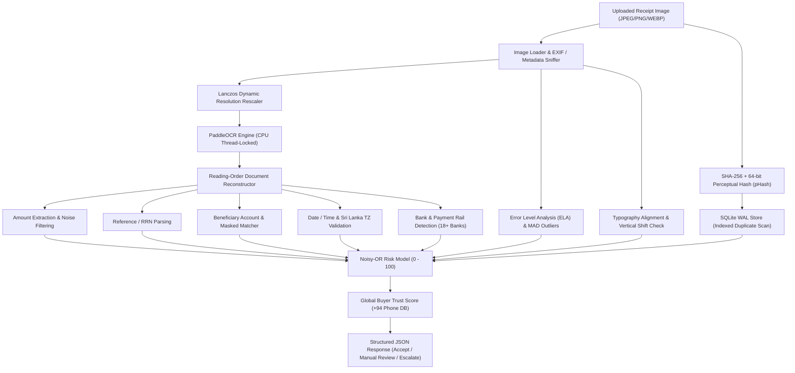

<p align="center">
  
</p>

<h1 align="center">Bank Receipt Verification Engine</h1>

<p align="center">
  <strong>Production-grade AI OCR, forensic tampering analysis, duplicate detection, and buyer trust scoring for Sri Lankan bank slips and digital wallets.</strong>
</p>

<p align="center">
  
  
  
  
  
  
</p>

---

## 📑 Table of Contents

- [Overview](#-overview)
- [System Architecture & Pipeline](#-system-architecture--pipeline)
- [Core Features](#-core-features)
- [Deep Dive: Engines Inside `main.py`](#-deep-dive-engines-inside-mainpy)
  - [1. Optical Character Recognition (OCR) Engine](#1-optical-character-recognition-ocr-engine)
  - [2. Intelligent Field Extraction & Normalization](#2-intelligent-field-extraction--normalization)
  - [3. Sri Lankan Bank & Payment Rail Recognition](#3-sri-lankan-bank--payment-rail-recognition)
  - [4. Forensic Image & Tampering Analysis](#4-forensic-image--tampering-analysis)
  - [5. Duplicate & Resubmission Engine](#5-duplicate--resubmission-engine)
  - [6. Global Buyer Trust Score & Feedback Loop](#6-global-buyer-trust-score--feedback-loop)
  - [7. Probabilistic Risk Aggregation (Noisy-OR)](#7-probabilistic-risk-aggregation-noisy-or)
- [API Reference](#-api-reference)
  - [`POST /verify-receipt`](#post-verify-receipt)
  - [`GET /buyers/{phone}/trust`](#get-buyersphonetrust)
  - [`POST /receipts/{receipt_id}/verdict`](#post-receiptsreceipt_idverdict)
  - [`GET /health`](#get-health)
- [Deploying to Railway.app](#-deploying-to-railwayapp)
- [Environment Configuration](#-environment-configuration)
- [Local Development & Docker](#-local-development--docker)
- [Testing with Postman](#-testing-with-postman)
- [Financial Disclaimer](#-financial-disclaimer)

---

## 🔍 Overview

In Sri Lankan e-commerce and social commerce, manual bank transfer slips (uploaded via WhatsApp, Instagram, or checkout forms) represent a major payment method. However, merchants frequently face:
1. **Reused Slips:** The same transaction slip submitted for multiple orders.
2. **Altered Slips:** Digitally modified amounts, dates, or accounts using tools like Photoshop, Canva, or PicsArt.
3. **Failed / Pending Slips:** Slips showing unapproved or pending transactions disguised as successful payments.
4. **Serial Fraudsters:** Buyers repeatedly submitting fake slips across different merchants.

The **eMerchantLK Receipt Verification Engine** (`main.py`) provides automated real-time triage for merchant workflows. In under a second, it executes optical character recognition, parses amounts and references, classifies the issuing bank, checks image compression anomalies, inspects typography alignments, matches cryptographic and perceptual duplicates, and cross-references a persistent Global Buyer Trust Score.

---

## 🏗 System Architecture & Pipeline



---

## ✨ Core Features

- **PaddleOCR 3.x / 2.x Compatibility:** Runs seamlessly on both modern PaddleX pipelines and legacy PaddleOCR wheels with zero code modifications.
- **Sri Lanka Banking Intelligence:** Pre-tuned signatures for 18+ commercial banks and digital payment apps (BOC, Commercial Bank, FriMi, Sampath, HNB, People's Bank, iPay, Dialog Genie, etc.) and payment rails (CEFT, JustPay, LankaQR, SLIPS).
- **Multi-Vector Forensic Tampering Checks:**
  - EXIF & XMP software signatures (detecting Canva, Photoshop, PicsArt, Photopea, etc.).
  - Error Level Analysis (ELA) with Median Absolute Deviation (MAD) outlier detection on numeric bounding boxes.
  - Typography alignment checking for baseline shifts and font height scaling discrepancies on amounts and references.
- **Two-Stage Duplicate Detection:**
  - Instant cryptographic `SHA-256` matching for identical file uploads.
  - Perceptual `pHash` (64-bit Hamming distance) bounded scan to catch cropped, resized, or re-saved duplicate screenshots.
  - Cross-order reference reuse detection.
- **Global Buyer Trust Score:**
  - Automatically tracks Sri Lankan phone numbers (`+94XXXXXXXXX`).
  - Adjusts scores dynamically based on merchant verdicts (fraud penalties vs. approved bonuses).
  - Flags low-trust buyers before orders are processed.
- **Built for Railway.app:** Designed for containerized hosting with dynamic `$PORT` handling, persistent SQLite Railway Volumes, and memory optimization.

---

## 🧠 Deep Dive: Engines Inside `main.py`

### 1. Optical Character Recognition (OCR) Engine
- **Class:** `OcrEngine`
- **Concurrency & Stability:** PaddlePaddle C++ predictors are not thread-safe. `OcrEngine` enforces a process-level `threading.Lock()` so concurrent FastAPI requests safely queue through inference without memory faults or crashes.
- **Dynamic Pre-Scaling (`prepare_for_ocr`):** Images are inspected before OCR. Images with the longest side exceeding `1800px` are downscaled via Lanczos resampling to prevent high CPU latency, while tiny receipts under `900px` are upscaled `2x` to improve text recognition on low-resolution mobile screenshots. Bounding boxes are automatically remapped to native pixel coordinates.
- **Spatial Line Reconstruction (`Document.build`):** Rather than reading raw unorganized OCR boxes, items are sorted vertically and horizontally into lines using median token heights, joining rows with newline characters (`\n`) while preserving character offset maps.

### 2. Intelligent Field Extraction & Normalization
- **Amount Extraction (`extract_amount`):**
  - Matches currency symbols (`LKR`, `RS`, `Rs.`, `රු.`).
  - Handles OCR whitespace anomalies (e.g. `4, 500.00`, `1,250 . 00`).
  - **Context-Aware Scoring:** Evaluates adjacent words on the line. Positive terms (`TOTAL`, `PAID`, `SENT`, `TRANSFER`, `AMOUNT`) boost candidate scores, while negative terms (`FEE`, `CHARGE`, `BALANCE`, `COMMISSION`, `TAX`) penalize them to prevent picking up transaction fees instead of the transferred amount.
  - **Ambiguity Detection:** Detects and flags receipts with multiple competing amounts that lack clear contextual dominance.
- **Transaction Reference (`extract_reference`):**
  - Matches labeled tokens (`BANK REF`, `CYBER RECEIPT REF`, `TXN ID`, `RRN`, `TRACE NO`, `CONFIRMATION NO`).
  - Supports standard alphanumeric bank codes as well as hyphenated hex tokens (e.g., `A1B2-C3D4-E5F6`).
  - Excludes account numbers, telephone numbers, and date tokens from being falsely identified as references.
- **Beneficiary Account Verification (`verify_beneficiary_account`):**
  - Extracts full or masked destination account numbers (e.g., `1234****5678`).
  - Validates against `expected_account` provided by the merchant.
  - Supports full exact matching, prefix/suffix masked matching, and raises mismatch signals if transferred to a different bank account.
- **Date & Timestamp Processing (`extract_datetime`):**
  - Enforces Sri Lankan Standard Time (`LK_TZ = UTC+5:30`).
  - Parses ISO formats (`YYYY-MM-DD`), day-first formats (`DD/MM/YYYY`), and word-month formats (`12 Nov 2026`).
  - Validates receipt timestamps against the current time: flags receipts dated in the future or older than `MAX_RECEIPT_AGE_DAYS` (default 30 days).
- **Transaction Status (`detect_status`):**
  - Scans for terminal success states (`SUCCESS`, `COMPLETED`, `APPROVED`, `TRANSFERRED`).
  - Catches failed or pending states (`FAILED`, `DECLINED`, `REJECTED`, `PENDING`, `IN PROGRESS`).

### 3. Sri Lankan Bank & Payment Rail Recognition
- **Function:** `detect_bank(doc, image_height)`
- **Spatial Weighting:** Bank logos and names located in the upper 25% of the receipt receive double weighting (`zone = 2`).
- **Beneficiary Bank Separation:** Destination lines containing `TO BANK` or `BENEFICIARY BANK` are isolated to avoid misclassifying the merchant's receiving bank as the payer's issuing bank app.
- **Supported Institutions & Apps:**
  - **Commercial Bank:** Commercial Bank, ComBank, Flash, Cyber Receipt, Q+
  - **Bank of Ceylon (BOC):** Bank of Ceylon, BOC, SmartPay, B App
  - **FriMi / Nations Trust Bank:** FriMi, Nations Trust, NTB
  - **Sampath Bank:** Sampath Bank, Vishwa, WePay
  - **Hatton National Bank:** HNB, Hatton National, SOLO
  - **People's Bank:** People's Bank, People's Wave, People's Pay
  - **Digital Wallets:** iPay (LOLC), Dialog Genie, Dialog Finance
  - **Other Commercial & Savings Banks:** NSB, Seylan Bank, NDB (NEOS), DFCC (DFCC One), Pan Asia Bank, Union Bank (UBgo), Cargills Bank, Amana Bank, HSBC Sri Lanka, Standard Chartered.
- **Payment Rails Identified:** `CEFT`, `JustPay`, `LankaQR`, `SLIPS`.

### 4. Forensic Image & Tampering Analysis
- **Metadata Sniffing (`analyze_metadata`):**
  - Extracts EXIF tags and Adobe XMP packets (`<x:xmpmeta>`).
  - Sniffs for editing software signatures (`photoshop`, `canva`, `picsart`, `pixlr`, `photopea`, `paint.net`, `figma`, `snapseed`, `lightroom`, `ibis paint`).
- **Error Level Analysis (`compute_ela` & `ela_numeric_outliers`):**
  - Re-saves the image at 90% JPEG quality to compute compression loss delta surfaces.
  - Runs Median Absolute Deviation (MAD) statistical outlier analysis on every numeric OCR token.
  - If the compression artifacts on the amount or date deviate significantly ($z \ge 4.0$) from surrounding peer numbers, an ELA tampering signal is raised.
- **Typography Alignment Check (`check_typography_alignment`):**
  - Compares the vertical centroid ($Y_c$) and bounding box height of extracted amount and reference boxes with neighboring tokens on the same horizontal row.
  - Flags pasted or edited text that exhibits abnormal baseline shifts or scaling variances.

### 5. Duplicate & Resubmission Engine
- **Storage:** SQLite with Write-Ahead Logging (`PRAGMA journal_mode=WAL`).
- **Two-Stage Lookup:**
  1. **B-Tree Query:** Instant lookups on indexed `sha256` and `reference` columns.
  2. **Perceptual Window Scan:** Custom deterministic SQLite function `hamming_hex` computes the bit distance across the latest receipts using `pHash`.
- **Duplicate Triage Logic:**
  - **Same Order Resubmission:** Same file uploaded for the *same* `order_id` is marked safe (score 0.0).
  - **Cross-Order Reuse:** Same reference or image submitted for a *different* `order_id` raises high-risk duplicate signals.
  - **Tampered Amount Reuse:** Same transaction reference but different parsed amounts triggers an immediate critical fraud signal (`reference_reused_different_amount`, weight 0.92).

### 6. Global Buyer Trust Score & Feedback Loop
- **Phone Normalization:** Sri Lankan phone numbers are standardized to international E.164 format:
  - `0771234567` $\rightarrow$ `+94771234567`
  - `771234567` $\rightarrow$ `+94771234567`
- **Dynamic Trust Score Model:**
  - New buyers start at **100/100**.
  - **Fraud Verdict:** When a merchant flags a receipt as `rejected_fraud`, the buyer loses **35 points** and increments their `flagged_count`.
  - **Approved Verdict:** Clean approvals reward **+2 points** (capped at 100).
  - **Low Trust Warning Banner:** Triggered whenever a buyer's score drops below `60` or when `flagged_count > 0`.

### 7. Probabilistic Risk Aggregation (Noisy-OR)
Rather than simple addition, risks are aggregated via **Noisy-OR Independence Combination**:

$$\text{Risk Score} = 100 \times \left(1 - \prod_{s \in \text{Signals}} (1 - \text{weight}_s)\right)$$

This ensures that:
- A single severe signal (e.g. exact duplicate or ELA tampering) immediately drives the risk to high.
- Multiple minor signals compound naturally without exceeding 100.
- Safe signals (weight `0.0`) have zero impact on the final score.

| Score Range | Risk Level | Merchant Recommendation |
| :--- | :--- | :--- |
| **0.0 – 19.9** | `low` | `accept` |
| **20.0 – 49.9** | `medium` | `manual_review` |
| **50.0 – 100.0** | `high` | `escalate` |

---

## 📡 API Reference

### `POST /verify-receipt`

Analyzes an uploaded bank slip image, extracts fields, performs forensics, and checks for duplicates.

#### Request Parameters (`multipart/form-data`)

| Parameter | Type | Required | Description |
| :--- | :--- | :---: | :--- |
| `file` | Binary | **Yes** | Receipt image file (`JPEG`, `PNG`, or `WEBP`, max 10MB). |
| `order_id` | String | No | Merchant's order/invoice ID (e.g. `ORD-2026-9876`). |
| `expected_amount` | Decimal | No | Expected order amount in LKR (e.g. `5000.00`). |
| `expected_account` | String | No | Merchant bank account number to verify on the slip. |
| `buyer_phone` | String | No | Buyer's phone number to query the Global Trust Score. |
| `register` | Boolean | No | Default `true`. Set `false` for dry runs without saving to DB. |
| `include_raw_text` | Boolean | No | Default `false`. Set `true` to return all OCR text lines. |

#### cURL Example

```bash
curl -X POST "http://localhost:8000/verify-receipt" \
  -F "file=@/path/to/slip.jpg" \
  -F "order_id=ORD-9921" \
  -F "expected_amount=3500.00" \
  -F "expected_account=8001234567" \
  -F "buyer_phone=+94771234567" \
  -F "register=true"
```

#### Example Response (`200 OK`)

```json
{
  "receipt_id": "c1f7292275e74d1aa47101de838c62fa",
  "registered": true,
  "risk": {
    "score": 4.5,
    "level": "low",
    "recommendation": "accept"
  },
  "signals": [
    {
      "code": "amount_matches_expected",
      "weight": 0.0,
      "detail": "Receipt amount equals the expected amount."
    },
    {
      "code": "beneficiary_account_matches",
      "weight": 0.0,
      "detail": "Beneficiary account matches expected merchant account."
    }
  ],
  "bank": {
    "name": "Commercial Bank",
    "confidence": 0.92,
    "beneficiary_bank": null,
    "payment_rails": ["CEFT"],
    "candidates": {
      "Commercial Bank": 12,
      "Sampath Bank": 0
    }
  },
  "fields": {
    "amount": {
      "value": "3500.00",
      "raw": "LKR 3,500.00",
      "confidence": 0.985
    },
    "reference": {
      "value": "COM20261112001",
      "raw": "COM20261112001",
      "confidence": 0.991
    },
    "datetime": {
      "value": "2026-11-12T14:30",
      "raw": "2026-11-12 14:30:15",
      "confidence": 0.978
    },
    "beneficiary_account": {
      "value": "8001234567",
      "raw": "8001234567",
      "confidence": 0.982
    },
    "status": "success"
  },
  "buyer_trust": {
    "phone": "+94771234567",
    "trust_score": 100,
    "flagged_count": 0,
    "verified_count": 5,
    "low_trust_warning": false,
    "warning_banner": null
  },
  "hashes": {
    "sha256": "4a7d1ed414474e4033ac29ccb8653d9b...",
    "phash": "f88cc33cc33c3c0f"
  },
  "forensics": {
    "metadata": {
      "format": "JPEG",
      "width": 1080,
      "height": 1920,
      "software": null,
      "editor_markers": [],
      "has_exif": true,
      "has_camera_exif": false
    },
    "ela": {
      "computed": true,
      "source_format": "JPEG",
      "reliable_source": true,
      "mean": 1.24,
      "p99": 8.45,
      "numeric_text_outliers": []
    }
  },
  "ocr": {
    "line_count": 24,
    "mean_confidence": 0.962,
    "low_confidence_count": 0
  },
  "processing_ms": 384
}
```

---

### `GET /buyers/{phone}/trust`

Retrieves trust metrics, verified count, and fraud history for a given phone number.

```bash
curl -X GET "http://localhost:8000/buyers/+94771234567/trust"
```

#### Response (`200 OK`)

```json
{
  "phone": "+94771234567",
  "trust_score": 30,
  "flagged_count": 2,
  "verified_count": 1,
  "low_trust_warning": true,
  "warning_banner": "Warning: Buyer has a low Global Trust Score (30/100) and 2 flagged slip(s)."
}
```

---

### `POST /receipts/{receipt_id}/verdict`

Allows merchants to record a manual verification verdict (1-tap approval or fraud rejection).

#### Request Parameters (`application/x-www-form-urlencoded`)

| Parameter | Type | Required | Values |
| :--- | :--- | :---: | :--- |
| `verdict` | String | **Yes** | `approved` or `rejected_fraud` |
| `buyer_phone` | String | No | Buyer's phone number to update trust records. |

```bash
curl -X POST "http://localhost:8000/receipts/c1f7292275e74d1aa47101de838c62fa/verdict" \
  -d "verdict=rejected_fraud" \
  -d "buyer_phone=+94771234567"
```

#### Response (`200 OK`)

```json
{
  "receipt_id": "c1f7292275e74d1aa47101de838c62fa",
  "verdict": "rejected_fraud",
  "buyer_trust": {
    "phone": "+94771234567",
    "trust_score": 65,
    "flagged_count": 1,
    "verified_count": 0
  }
}
```

---

### `GET /health`

Used by Railway and uptime monitors to verify container and OCR readiness.

```bash
curl -X GET "http://localhost:8000/health"
```

```json
{
  "status": "ok",
  "version": "2.1.0"
}
```

---

## 🚀 Deploying to Railway.app

This repository is optimized specifically for deployment on **[Railway.app](https://railway.app)**.

### Step 1: Connect Repository to Railway
1. Push your repository to GitHub.
2. In Railway, click **+ New Project** $\rightarrow$ **Deploy from GitHub repo**.
3. Select this repository. Railway will detect the `Dockerfile` and begin building.

### Step 2: Configure Persistent Railway Volume (Critical)
Because SQLite stores duplicate slips and buyer trust scores on disk, you must attach a persistent volume so data is not wiped between redeployments:

1. In Railway, click your service card.
2. Navigate to the **Volumes** tab.
3. Click **Add Volume**.
4. Set the **Mount Path** to:
   ```
   /app/data
   ```

### Step 3: Set Service Variables
Navigate to your Service $\rightarrow$ **Variables** in Railway and configure:

| Variable | Recommended Value | Purpose |
| :--- | :--- | :--- |
| `RECEIPT_DB_PATH` | `/app/data/receipts.db` | Points SQLite to the mounted persistent volume. |
| `RAILWAY_RUN_UID` | `0` | Ensures the container has write permissions to the volume. |
| `OMP_NUM_THREADS` | `1` | Prevents OpenBLAS thread thrashing on cloud vCPUs. |
| `MALLOC_ARENA_MAX` | `2` | Prevents memory fragmentation in glibc. |

> [!NOTE]
> Railway dynamically provides the `$PORT` environment variable. The `Dockerfile` entrypoint automatically binds Uvicorn to `${PORT:-8000}`.

### Step 4: Memory & Resources
PaddleOCR and OpenCV run in-memory inference. Allocate at least **1.5 GB to 2.0 GB of RAM** in Railway Service Settings to prevent container Out-Of-Memory (OOM) termination during batch OCR tasks.

---

## ⚙️ Environment Configuration

All environment variables are optional and provide sensible defaults:

| Variable | Type | Default | Description |
| :--- | :--- | :--- | :--- |
| `MAX_UPLOAD_BYTES` | Integer | `10485760` (10 MB) | Maximum allowable upload file size. |
| `MAX_PIXELS` | Integer | `25000000` (25 MP) | Maximum image resolution (prevents decompression bombs). |
| `MAX_RECEIPT_AGE_DAYS` | Integer | `30` | Age threshold before a receipt is flagged as stale. |
| `LOW_TRUST_THRESHOLD` | Integer | `60` | Score threshold below which buyer warning banners fire. |
| `PHASH_SCAN_LIMIT` | Integer | `5000` | Max recent receipts scanned during perceptual hash matching. |
| `RECEIPT_DB_PATH` | String | `receipts.db` | Filepath for the SQLite database. |

---

## 💻 Local Development & Docker

### Local Python Setup

1. **Clone & Create Environment:**
   ```bash
   git clone https://github.com/your-username/bank-slip-ocr.git
   cd bank-slip-ocr
   python -m venv venv
   
   # Windows
   .\venv\Scripts\activate
   # Linux / macOS
   source venv/bin/activate
   ```

2. **Install Dependencies:**
   ```bash
   pip install -r requirements.txt
   ```

3. **Start Development Server:**
   ```bash
   uvicorn main:app --host 0.0.0.0 --port 8000 --reload
   ```
   Open `http://localhost:8000/docs` to test endpoints via Swagger UI.

### Local Docker Testing

```bash
# Build Docker image
docker build -t bank-slip-ocr .

# Run with local volume mount
docker run -p 8000:8000 -v $(pwd)/data:/app/data bank-slip-ocr
```

---

## 🧪 Testing with Postman

A pre-configured Postman Collection is included in this repository:
- [`postman_collection.json`](file:///f:/Projects/bank-slip-ocr/postman_collection.json): Contains test cases for health check, valid receipt verification, duplicate detection, buyer trust checks, and merchant verdicts.
- [`postman_environment.json`](file:///f:/Projects/bank-slip-ocr/postman_environment.json): Environment variables targeting `http://localhost:8000` (or your deployed Railway URL).

### How to use:
1. Open Postman $\rightarrow$ **Import** $\rightarrow$ select both JSON files.
2. Select the **eMerchantLK Local Environment** in Postman.
3. Replace the `baseUrl` with your Railway production URL (`https://your-service.up.railway.app`) when testing live deployments.

---

## ⚠️ Financial Disclaimer

> [!IMPORTANT]
> This engine produces an automated **risk assessment** and **forensic triage** for merchant review. It does **NOT** constitute proof that funds have settled in a bank account. For high-value transactions, merchants must confirm fund clearance directly with their corporate online banking portal or SMS payment gateway alerts.
